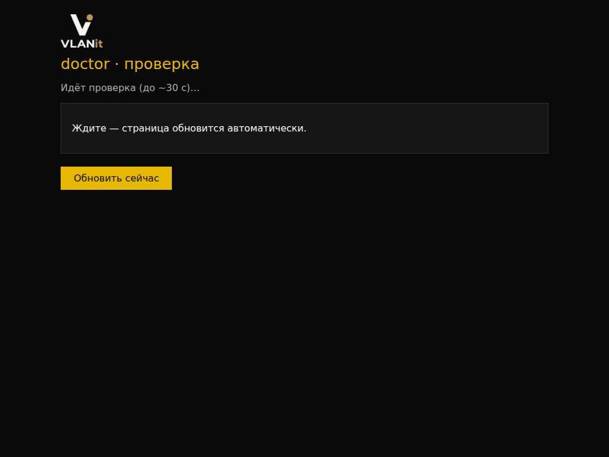
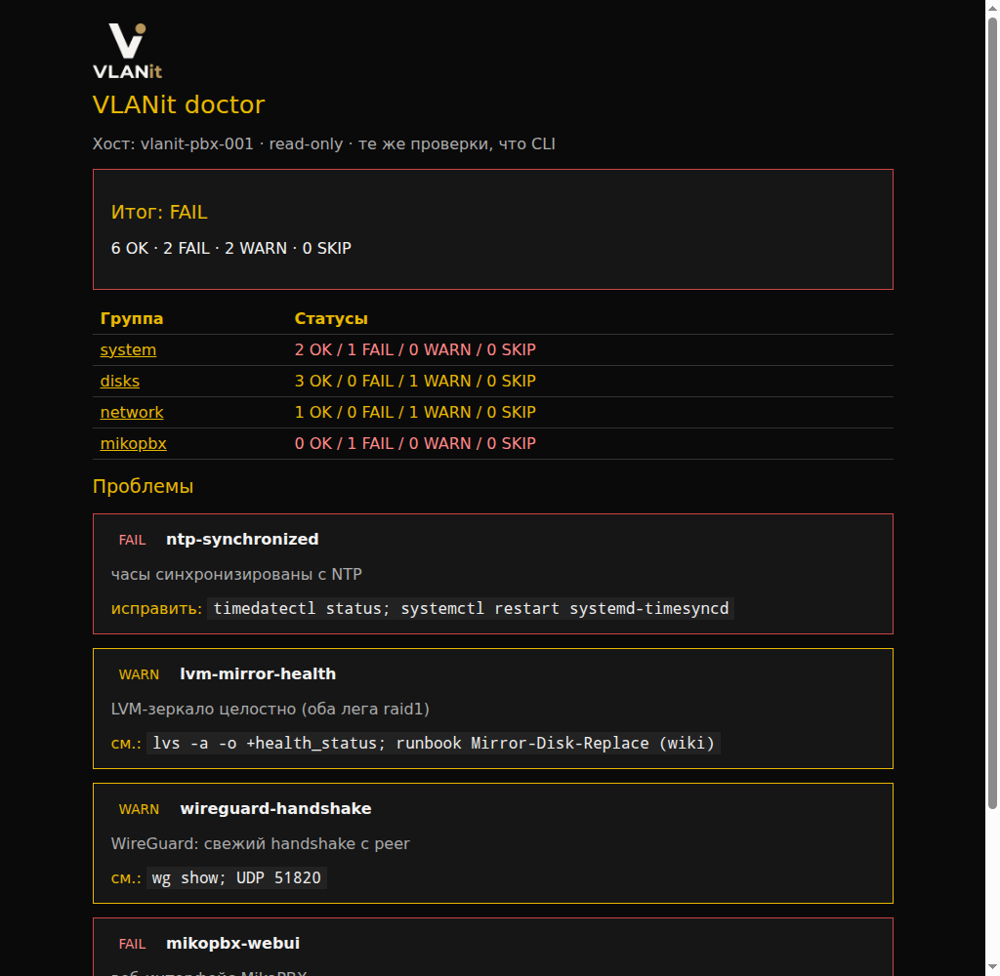
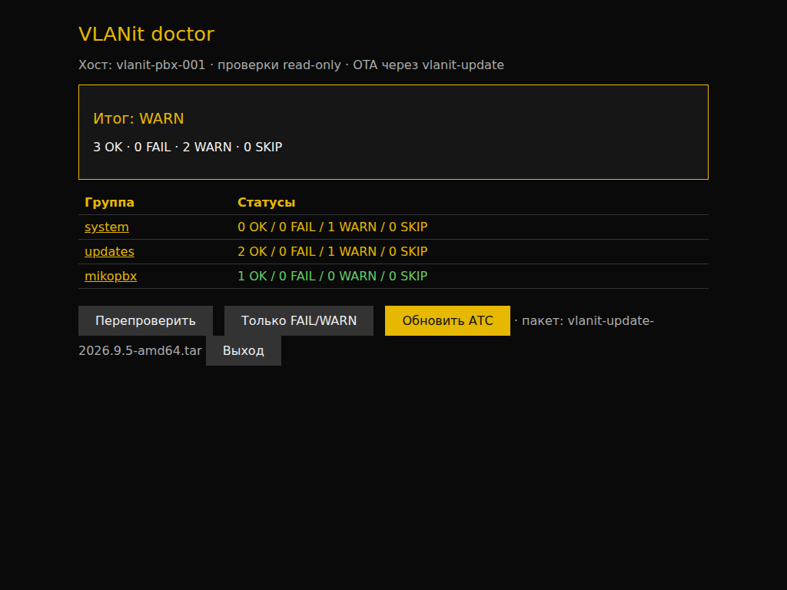
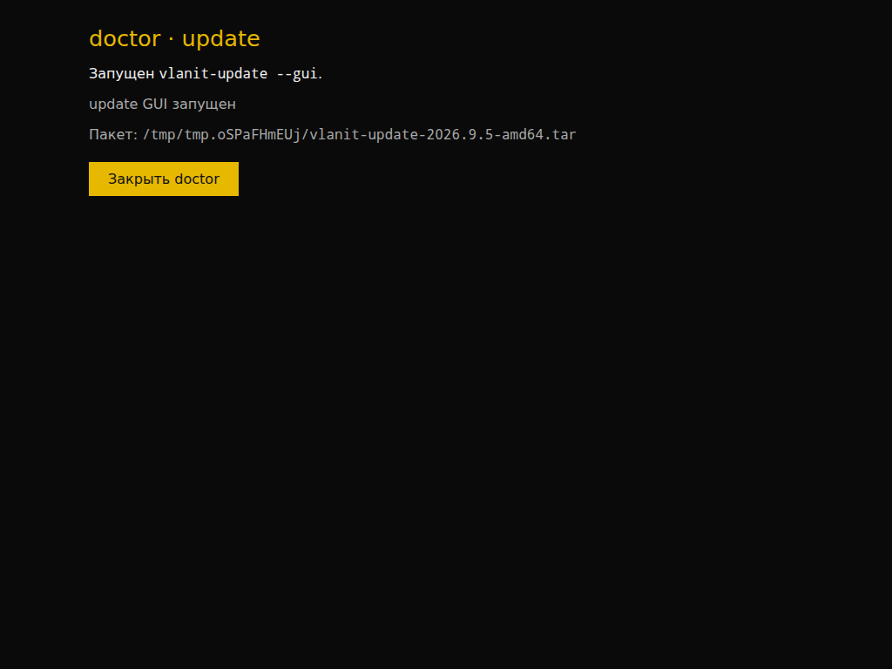

# Руководство: vlanit-doctor GUI

Диагностика установленной VLANit PBX OS на консоли (HTML + `netsurf-fb`),
по аналогии с GUI-установщиком. Issue #56.
Спека: [`docs/specs/vlanit-doctor-gui.md`](specs/vlanit-doctor-gui.md).
CLI as-built: [`docs/specs/1.2.8-vlanit-doctor.md`](specs/1.2.8-vlanit-doctor.md).
Установка / после firstboot: [`docs/installation.md`](installation.md) §5.
OTA с консоли: [`docs/update-gui.md`](update-gui.md) (issue #58).

Скрины — mock (`scripts/shot-update-gui.sh` для 05–06; ранее — doctor
fixtures). На боксе тот же UI, данные живые.

## Запуск

На устройстве (нужен `/dev/fb0`, обычно root):

```bash
sudo vlanit-doctor --gui
# или
sudo vlanit-doctor-gui
```

Без framebuffer — exit ≠0 и hint CLI. Стенд QEMU: `VLANIT_FB_SURFACE=sdl`.

CLI (SSH / скрипты):

```bash
vlanit-doctor              # полный отчёт
vlanit-doctor --quiet      # 0 = нет FAIL (WARN допустим)
vlanit-doctor --fix-hints
vlanit-doctor --json
```

## Что видно

1. **Progress** — идёт прогон (до ~30 с), auto-refresh.
2. **Сводка** — итог OK / WARN / FAIL, счётчики по группам.
3. **Группа** — каждая проверка + hint при FAIL/WARN.
4. **Только FAIL/WARN** — фильтр проблем.
5. **Обновить АТС** — только если на USB есть `vlanit-update-*.tar`+`.asc`
   → handoff в `vlanit-update --gui` (нет FB → CLI на консоли).
   Confirm YES **не** в doctor — только в мастере обновления.

Статусы: **OK** · **FAIL** · **WARN** · **SKIP**.
Проверки read-only (`--json` / `--quiet` не запускают OTA).

Группа **updates** (в т.ч.): `apt-upgradable`, `pre-update-snapshot`,
`mikopbx-image-pin`, `ota-package-present`, `ota-last-result`.

---

## Progress



## Сводка


## Только FAIL/WARN



## Группа disks (WARN зеркало)


## Группа system (FAIL NTP)


## Сводка с кнопкой «Обновить АТС»

Появляется, когда найден USB-пакет OTA. Рядом имя пакета.



## Handoff → vlanit-update --gui

После нажатия doctor сообщает о запуске мастера и предлагает закрыться
(освободить framebuffer). Дальше — шаги в [`update-gui.md`](update-gui.md).


