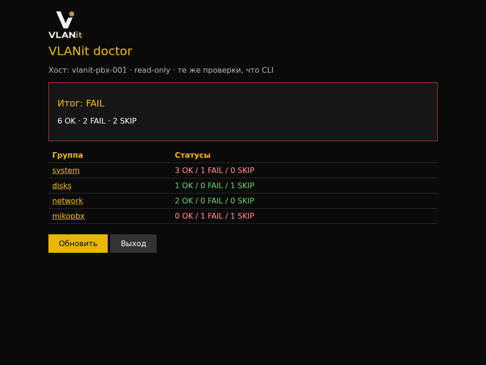
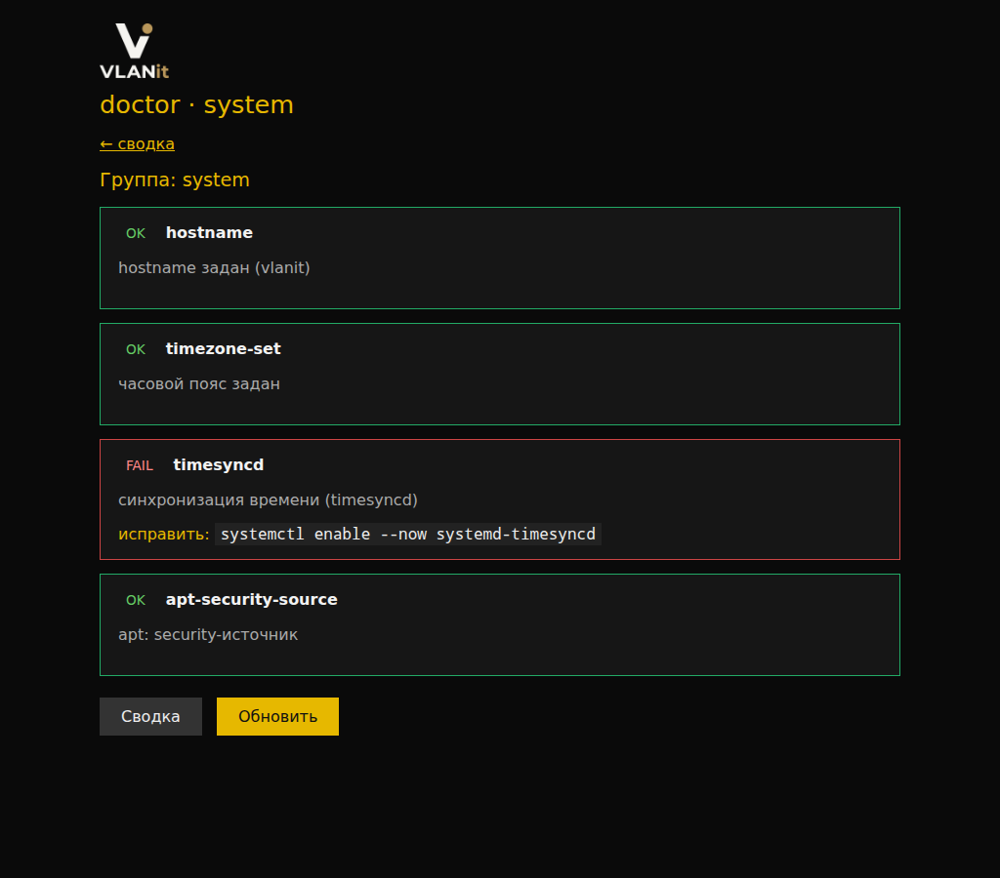
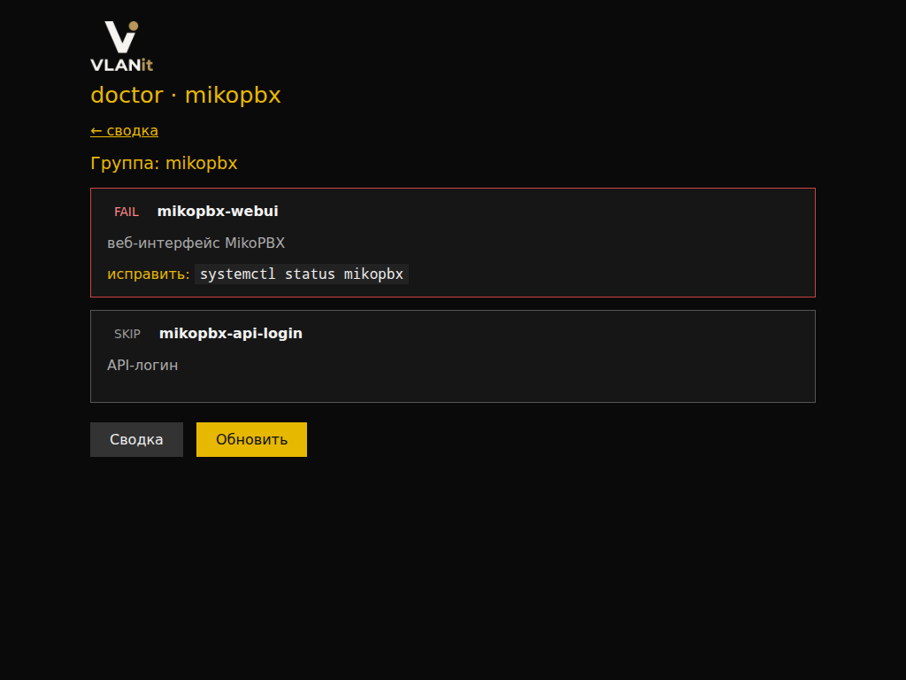

# Галерея: vlanit-doctor GUI (#56)

HTML + framebuffer (как установщик). Mock-данные для скринов
(не живой прогон на боксе).

```bash
# переснять:
# (см. scripts — пока chrome headless на VLANIT_DOCTOR_CMD fixture)
ls docs/doctor-gui/shots/
```

## 1. Сводка



## 2. Группа system (FAIL + hint)



## 3. Группа mikopbx



Запуск на устройстве: `sudo vlanit-doctor --gui`.  
Спека: `docs/specs/vlanit-doctor-gui.md`.
