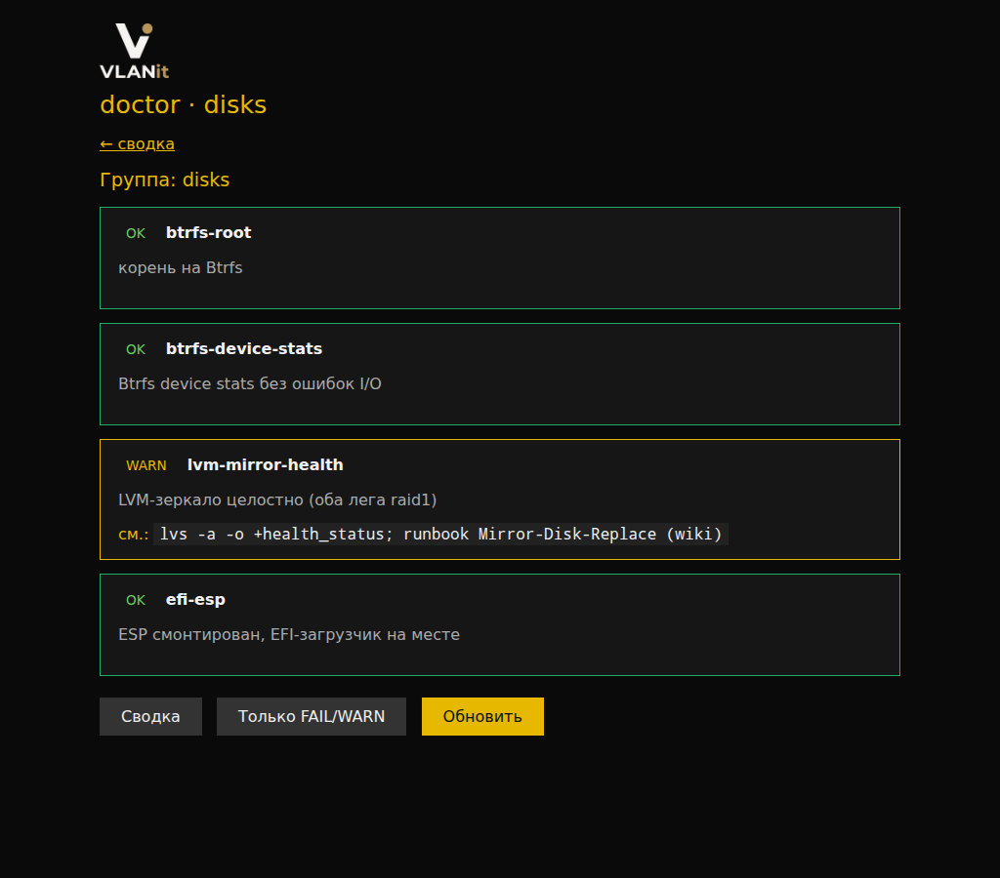
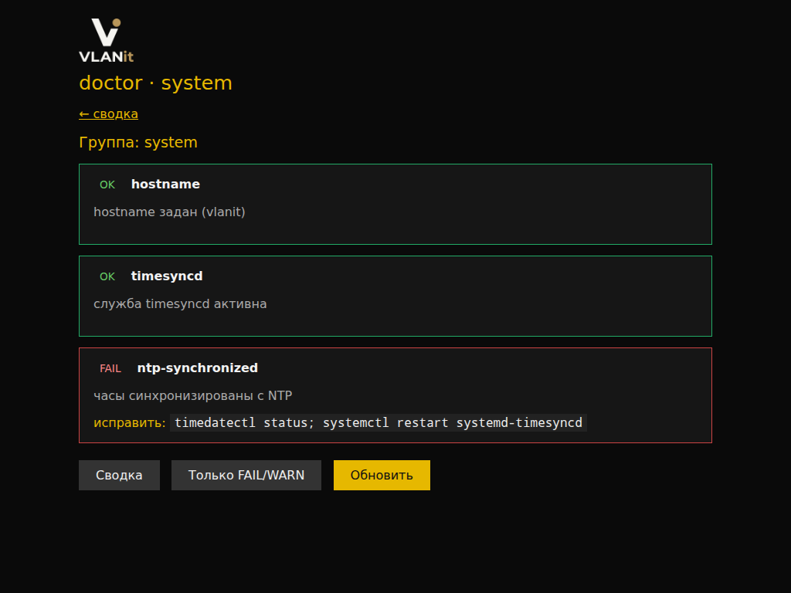

# Руководство: vlanit-doctor GUI

Диагностика установленной VLANit PBX OS на консоли (HTML + `netsurf-fb`),
по аналогии с GUI-установщиком. Issue #56.
Спека: [`docs/specs/vlanit-doctor-gui.md`](specs/vlanit-doctor-gui.md).
CLI as-built: [`docs/specs/1.2.8-vlanit-doctor.md`](specs/1.2.8-vlanit-doctor.md).
Установка / после firstboot: [`docs/installation.md`](installation.md) §5.

## Запуск

На устройстве (нужен `/dev/fb0`, обычно root):

```bash
sudo vlanit-doctor --gui
# или
sudo vlanit-doctor-gui
```

Без framebuffer процесс завершится с подсказкой использовать CLI.
Для стенда QEMU: `VLANIT_FB_SURFACE=sdl`.

CLI (SSH / скрипты):

```bash
vlanit-doctor              # полный отчёт
vlanit-doctor --quiet      # 0 = нет FAIL (WARN допустим)
vlanit-doctor --fix-hints
vlanit-doctor --json
```

## Что видно

1. **Progress** — идёт прогон (до ~30 с), auto-refresh.
2. **Сводка** — итог OK / WARN / FAIL, счётчики по группам.
3. **Группа** — каждая проверка + hint при FAIL/WARN.
4. **Только FAIL/WARN** — фильтр проблем.

Статусы: **OK** · **FAIL** · **WARN** (напр. degraded LVM mirror) · **SKIP**.
GUI ничего не меняет в системе.

Скрины ниже — mock (типичный FAIL+WARN), не живой бокс.

---

## Progress


## Сводка


## Только FAIL/WARN


## Группа disks (WARN зеркало)



## Группа system (FAIL NTP)


