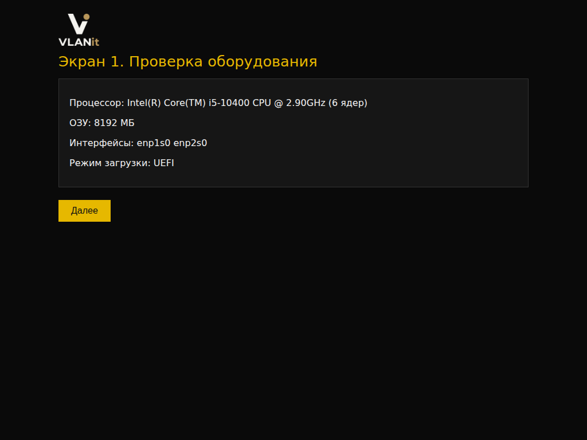
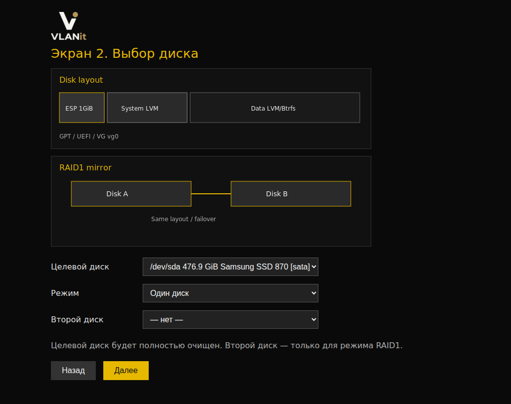
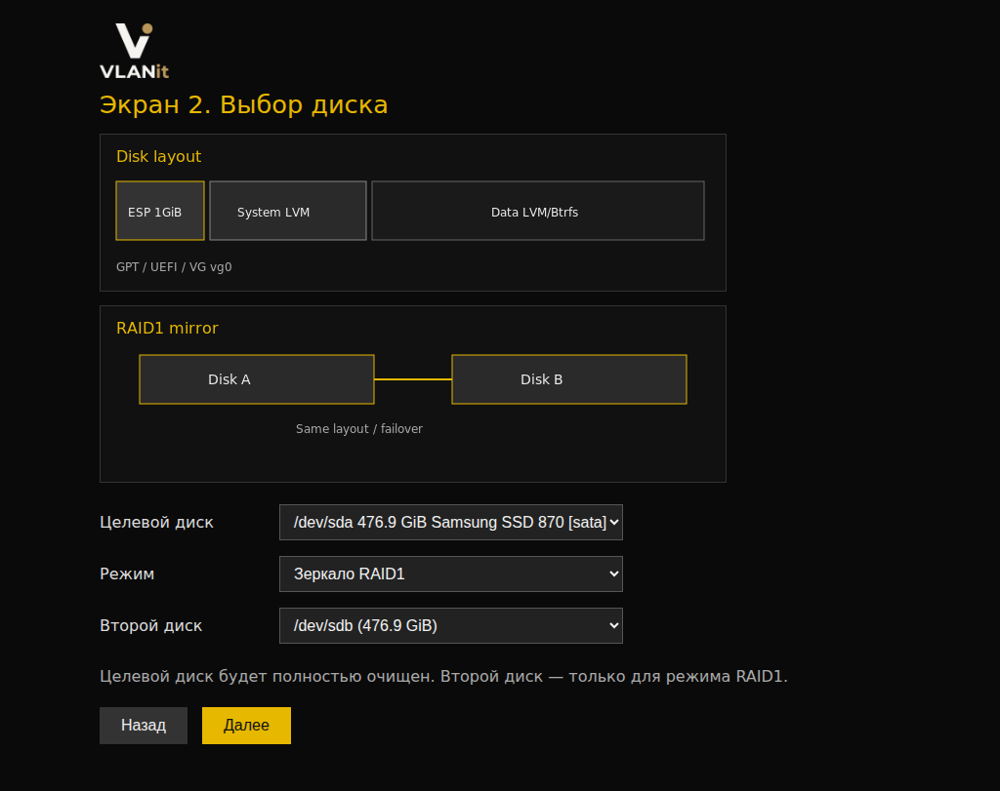
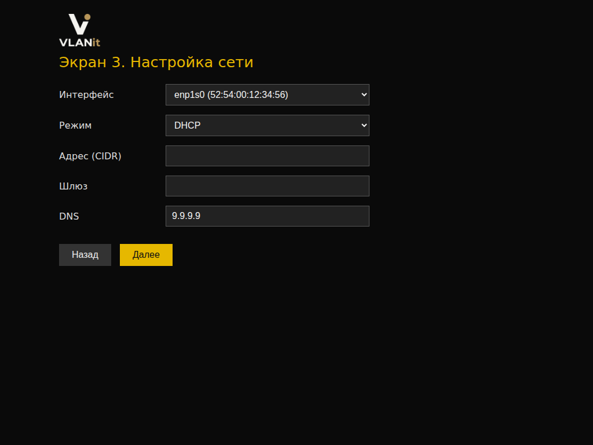
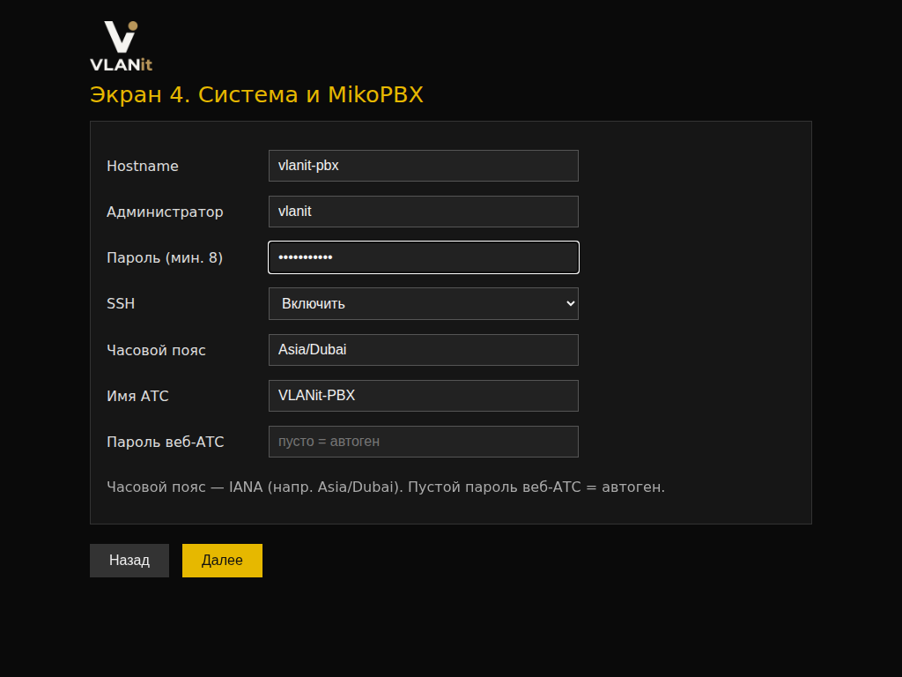
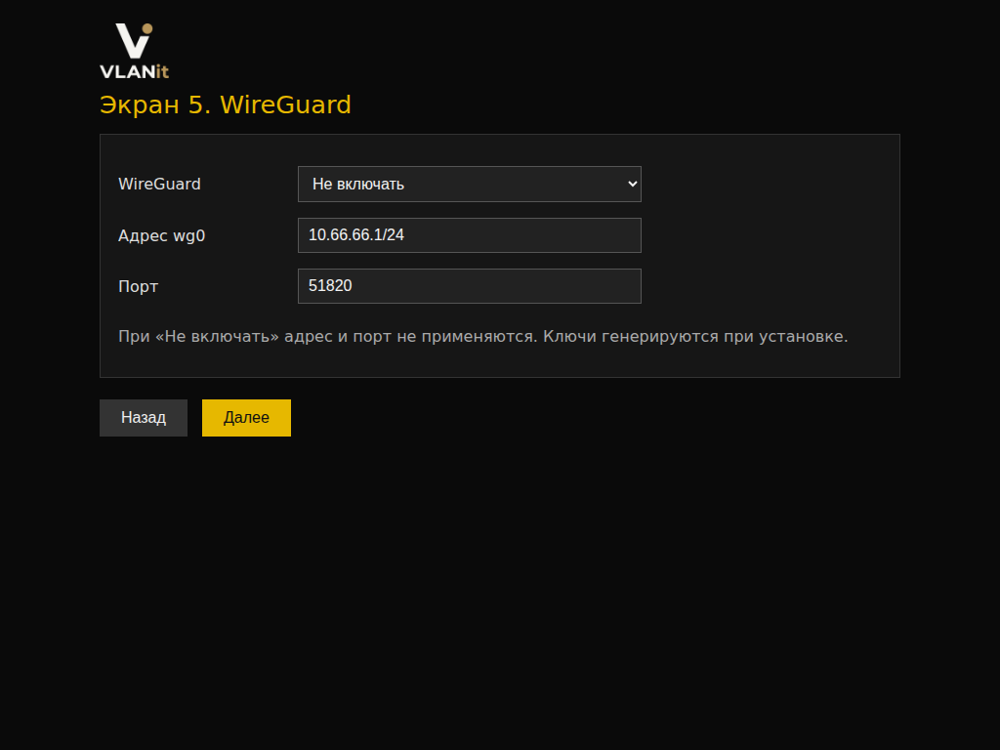
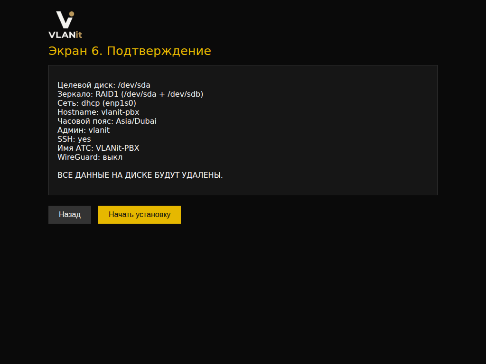
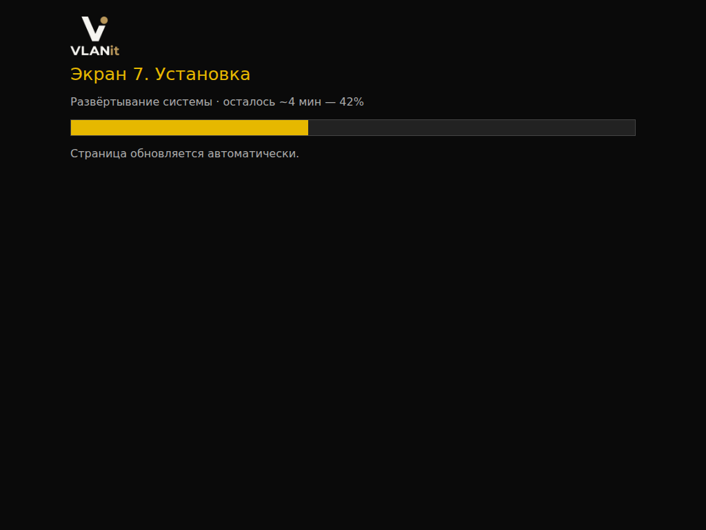
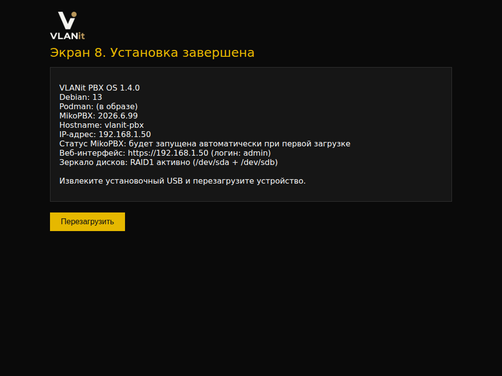

# GUI-установщик VLANit PBX OS

**Primary:** HTML-мастер на `netsurf-fb` (`sdl` + `SDL_VIDEODRIVER=fbcon`
на `/dev/fb0`). **Запасные:** Cursive TUI (`vlanit-tui`), затем `dialog`.
`vlanit.ui=gui|tui|dialog` — только принудительный выбор, не дефолт.
Спека: [`docs/specs/gui-installer.md`](specs/gui-installer.md);
полевое #60/#61: [`docs/specs/field-gui-tui-60-61.md`](specs/field-gui-tui-60-61.md).
Идея #12: [`docs/ideas/gui-installer.md`](ideas/gui-installer.md).

Скрины ниже — mock-probe (типичный 2×SSD UEFI), сняты
`scripts/shot-gui-html.sh` → `docs/gui-installer/shots/`. На железе/ISO
тот же UI; данные оборудования реальные. QEMU headless часто не
удерживает netsurf — тогда виден TUI (цепочка fallback), не смена primary.

Пересъёмка:

```bash
docker run --rm -v "$PWD:/build" -w /build vlanit-build:1.2 \
  python3 scripts/render-gui-assets.py
bash scripts/shot-gui-html.sh
cp -a build/release-shots/gui-installer/*.png docs/gui-installer/shots/
```

Брендинг: `VLANIT_BRANDING=<profile>` → `installer/branding/<profile>/`.
Экраны: `installer/screens.yaml` (`enabled: false` — пропуск шага).

---

## Экран 1 — оборудование

CPU/ОЗУ/интерфейсы/UEFI. Без UEFI мастер не пускает дальше.



## Экран 2 — диск

Схема разметки (ESP / System LVM / Data). Диск будет очищен.



### Зеркало RAID1

Режим «Зеркало» + второй диск; схема двух дисков.



## Экран 3 — сеть

Интерфейс, DHCP или static (адрес/шлюз/DNS на одной странице).



## Экран 4 — система и MikoPBX

Hostname, админ, пароль, SSH, TZ, имя/пароль АТС. Без WireGuard
(отдельный шаг). Валидация на сервере (NetSurf без JS).



## Экран 5 — WireGuard

Включить после установки или нет; адрес wg0 и порт (при «нет» —
игнорируются).



## Экран 6 — подтверждение

Сводка перед деструктивными этапами (в т.ч. состояние WG).



## Экран 7 — прогресс

Percent + статус + ETA; meta-refresh без JS.



## Экран 8 — завершение

IP, URL веб-админки, опционально сген. пароль / WG pubkey / RAID.



---

## Primary / fallback

| Условие | UI |
|---|---|
| `/dev/fb0` + `netsurf-fb` | **HTML primary** (`sdl`+fbcon; Debian без surface `linux`, #60) |
| нет fb / GUI упал | Cursive TUI (`vlanit-tui`) |
| нет бинаря TUI | `dialog` (тема 1.3.3) |
| `vlanit.ui=…` | принудительно gui/tui/dialog |
| `autoinstall.yaml` | без UI |

Лог collect: `UI primary=gui; fallback=tui|dialog`; при падении netsurf —
`GUI fail → fallback tui` (лог `/run/vlanit/gui-netsurf.log`).

## Связанные файлы

- `installer/screens.yaml` — реестр экранов (порядок / enabled)
- `installer/branding/<profile>/` — branding.yaml, theme.css, logo
- `installer/gui/` — HTTP, templates, static
- `installer/bin/vlanit-probe` — JSON для UI
- `installer/lib/{config-json,install-run,ui-select}.sh`
- `installer/tui-cursive/` — Cursive; сборка `scripts/build-tui.sh`
