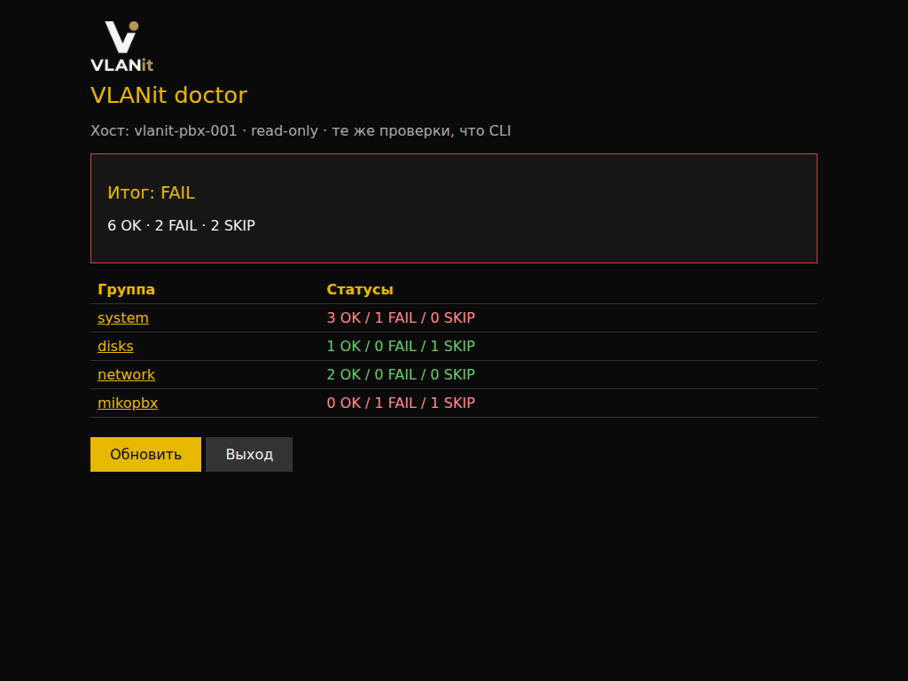
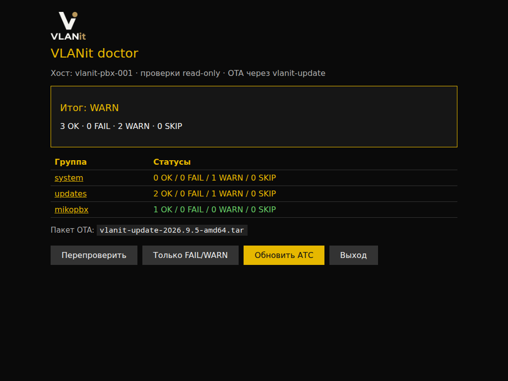

# Установка VLANit PBX OS

## 1. Создание загрузочной флэшки

Ниже — несколько способов записать ISO на USB-накопитель (8+ ГБ).
Все способы равнозначны; выберите удобный. **Внимание: все данные
на флэшке будут удалены.**

### Способ 1. Linux: скрипт write-usb.sh (рекомендуемый)

Самый безопасный способ: скрипт показывает модель и размер диска,
проверяет смонтированные разделы и требует явного подтверждения.

```bash
sudo bash scripts/write-usb.sh dist/VLANit-PBX-1.4.5-amd64.iso /dev/sdX
```

(`/dev/sdX` — ваша флэшка, например `/dev/sdb`; точное имя смотрите
в выводе `lsblk -o NAME,SIZE,MODEL,TRAN`.)

Эквивалент вручную:

```bash
sudo dd if=VLANit-PBX-1.4.5-amd64.iso of=/dev/sdX bs=4M status=progress oflag=sync
sync
```

### Способ 2. Linux: графические утилиты (без терминала)

- **GNOME Disks (Диски)** — Ubuntu/Fedora/Debian с GNOME:
  выбрать флэшку → меню ⋮ → «Восстановить образ диска» → выбрать ISO.
- **KDE ISO Image Writer** — в KDE: «Запись образа» → выбрать ISO и флэшку.
- **balenaEtcher** — кроссплатформенная (Linux/Windows/macOS):
  скачать с https://etcher.balena.io → «Flash from file» → выбрать ISO и
  накопитель → Flash.

### Способ 3. Windows: Rufus или balenaEtcher

- **Rufus** (https://rufus.ie): выбрать ISO → в диалоге режима записи
  выбрать **«DD-образ»** (важно: не «ISO-образ») → «Старт».
- **balenaEtcher**: как в способе 2.

### Способ 4. macOS: dd или balenaEtcher

```bash
# узнать идентификатор флэшки, например disk4
diskutil list
diskutil unmountDisk /dev/disk4
sudo dd if=VLANit-PBX-1.4.5-amd64.iso of=/dev/rdisk4 bs=4m
diskutil eject /dev/disk4
```

### Способ 5 (опционально). Ventoy

Если флэшка уже подготовлена [Ventoy](https://ventoy.net), достаточно
скопировать ISO обычным копированием в корень флэшки. Загрузка
выполняется через меню Ventoy (выбрать ISO → UEFI).

### Проверка записи

Контрольные суммы релиза подписаны GPG-ключом релиза (CI, с 1.2.9).
Проверяйте подпись перед записью — так вы убеждаетесь, что ISO пришёл
неизменённым от сборки:

```bash
# 1) подпись контрольной суммы (публичный ключ — в репозитории, rootfs/etc-vlanit-release.pub)
gpg --no-default-keyring --keyring rootfs/etc-vlanit-release.pub \
    --verify dist/VLANit-PBX-1.4.5-amd64.iso.sha256.asc
# ожидается: «Действительная подпись VLANit PBX OS Release»

# 2) целостность образа
sha256sum -c dist/VLANit-PBX-1.4.5-amd64.iso.sha256   # сверить образ до записи
# после записи — сравнить первые блоки (Linux):
sudo head -c 1G /dev/sdX | sha256sum   # должно совпасть с началом образа
```

## 2. Загрузка устройства

1. Вставьте USB, включите устройство, войдите в меню загрузки (F11/F12/Boot Menu).
2. Выберите UEFI-загрузку с USB. Требуется UEFI (Legacy BIOS не поддерживается).
3. В меню GRUB выберите «Установить VLANit PBX OS … (UEFI)».

Live-среда загрузится и запустит VLANit Installer. По умолчанию —
**графический мастер** (HTML на framebuffer через `netsurf-fb`). Если
нет `/dev/fb0` или GUI не стартовал — Cursive TUI (`vlanit-tui`), затем
`dialog`. Принудительно: в cmdline GRUB `vlanit.ui=gui|tui|dialog`.

Галерея экранов: [`docs/gui-installer.md`](gui-installer.md).

## 3. Мастер установки

Экраны задаются реестром `installer/screens.yaml` (порядок / `enabled`);
GUI и TUI — одни шаги, бэкенд общий. Галерея:
[`docs/gui-installer.md`](gui-installer.md).

1. **Оборудование** — CPU, ОЗУ, накопители, сеть, UEFI. Без UEFI —
   дальше нельзя.
2. **Диск** — целевой накопитель (USB исключён); схема ESP / System /
   Data. При втором диске — один диск или **зеркало RAID1**.
3. **Сеть** — интерфейс, DHCP или static.
4. **Система** — hostname, админ (пароль ≥ 8), SSH, TZ, имя/пароль
   веб-АТС (пустой → автоген).
5. **WireGuard** — включить после установки или нет; адрес wg0 и порт
   (при «нет» не применяются).
6. **Подтверждение** — сводка (в т.ч. WG) перед стиранием диска.
7. **Установка** — прогресс % / статус / ETA; журнал
   `/var/log/vlanit-install.log`.
8. **Завершение** — IP, URL веб, пароль АТС / WG pubkey при наличии,
   reboot.

Минимум диска: Data-LV ≥ 8 GiB при `installer.system_size_pct` (по
умолчанию 25 % usable). Для продакшена ориентир ≥ 50 GiB. Меньше
минимума — отказ с пояснением до деструктивных этапов.

## Часовой пояс

Мастер (экран «Система», с 1.2.9) спрашивает IANA-часовой пояс
(по умолчанию `Asia/Dubai`). Установщик пишет `/etc/timezone` и
`/etc/localtime`, в контейнер АТС — `TZ` + `PBX_TIMEZONE` (DockerCloud
применяет `PBXTimezone` при каждом старте). Синхронизация —
systemd-timesyncd. Через autoinstall.yaml: ключ `timezone`
(например `Asia/Dubai`).

## WireGuard VPN (преднастройка при установке)

Если WireGuard включён в мастере (экран «WireGuard»), установщик:

- генерирует уникальную пару ключей устройства (`wg genkey`);
- создаёт `/etc/wireguard/wg0.conf` (адрес, например `10.66.66.1/24`,
  порт 51820, права 600);
- включает `wg-quick@wg0.service` (автозапуск при загрузке);
- включает форвардинг IPv4/IPv6 (`/etc/sysctl.d/99-vlanit-wireguard.conf`);
- показывает **публичный ключ устройства** на экране завершения — его нужно
  добавить на пир.

Пиры добавляются вручную в `/etc/wireguard/wg0.conf` (шаблон в файле) или
через autoinstall (`wireguard.peers`):

```yaml
wireguard:
  enabled: true
  address: 10.66.66.1/24
  listen_port: 51820
  peers:
    - public_key: "<публичный ключ пира>"
      allowed_ips: "10.66.66.2/32"
```

Проверка после установки: `wg show`, `systemctl status wg-quick@wg0`.

## 4. Первоначальный доступ

После перезагрузки система выполнит первичную настройку (одноразово,
1–3 минуты), затем автоматически запустит MikoPBX. Первая инициализация
MikoPBX занимает до 3–6 минут.

- Веб-интерфейс АТС: `https://<IP-адрес>` (логин/пароль заданы в мастере;
  если пароль не задан — стандартные `admin`/`admin`, смените сразу).
- SSH на устройство: пользователь из мастера, порт 22.
- Консольное меню MikoPBX: `podman exec -it mikopbx /etc/rc/console_menu`.

## 5. Диагностика после установки

Сводный контроль — **`vlanit-doctor`** (read-only; те же проверки, что у
тест-агента). На консоли с монитором удобнее GUI:

```bash
sudo vlanit-doctor                 # CLI: OK / FAIL / WARN / SKIP
sudo vlanit-doctor --fix-hints     # команды исправления под FAIL/WARN
sudo vlanit-doctor --gui           # HTML + framebuffer (как установщик)
# или: sudo vlanit-doctor-gui
```

- Код `--quiet`: **0** = нет FAIL (WARN допустим, напр. degraded зеркало).
- GUI: сводка → группы; «Только FAIL/WARN»; без `/dev/fb0` — подсказка CLI.
- USB с пакетом OTA → кнопка **Обновить АТС** → [`vlanit-update --gui`](update-gui.md).
- Галереи: [`doctor-gui.md`](doctor-gui.md), [`update-gui.md`](update-gui.md).





Дополнительно вручную:

```bash
systemctl status mikopbx          # состояние контейнера
podman logs mikopbx               # журнал MikoPBX
journalctl -u vlanit-firstboot    # первичная настройка
journalctl -b                     # журнал загрузки
btrfs subvolume list /            # subvolumes
vlanit-snapshot list              # снапшоты
ip a; ip r                        # сеть
```

Признак готовности MikoPBX в журнале контейнера:
`All services are fully loaded welcome`.

## Автоматическая установка (для тестов/массового развёртывания)

Если в корне ISO есть `/autoinstall.yaml`, UI не запускается — те же этапы
из YAML (см. `tests/integration/autoinstall.yaml`):

```yaml
disk: /dev/sda
# mirror: yes            # зеркало RAID1 двух дисков
# mirror_disk: /dev/sdb # второй диск (если не задан — первый другой кандидат)
hostname: vlanit-pbx-001
network: { mode: dhcp }
admin: { user: vlanit, password: "..." }
mikopbx: { name: VLANit-PBX-001, web_admin_password: "..." }
confirm: yes
```

Защита: диск из списка внутренних кандидатов; Data ≥ `DATA_MIN_GIB`
(при зеркале — у каждого); checksums payload до разметки.
На железе осторожно: `confirm: yes` = полное стирание.
