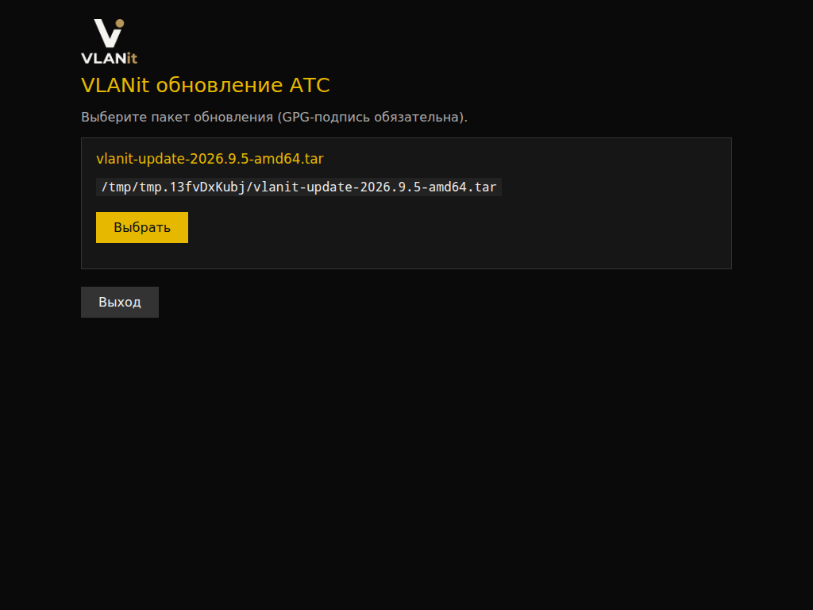
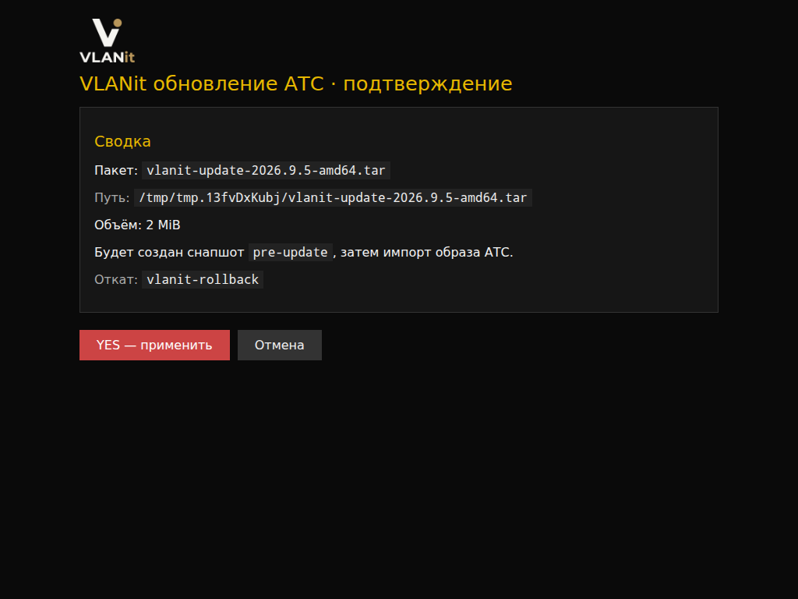
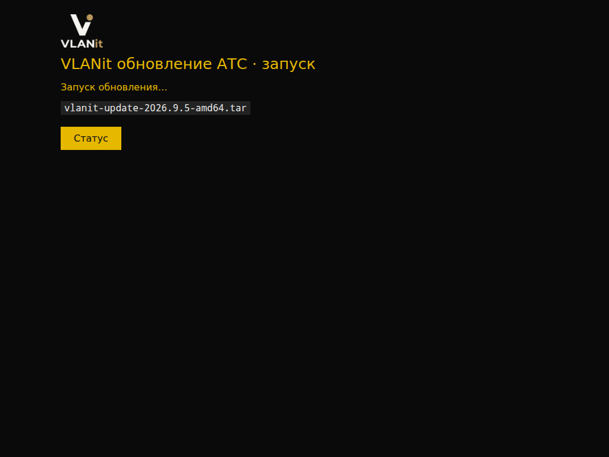
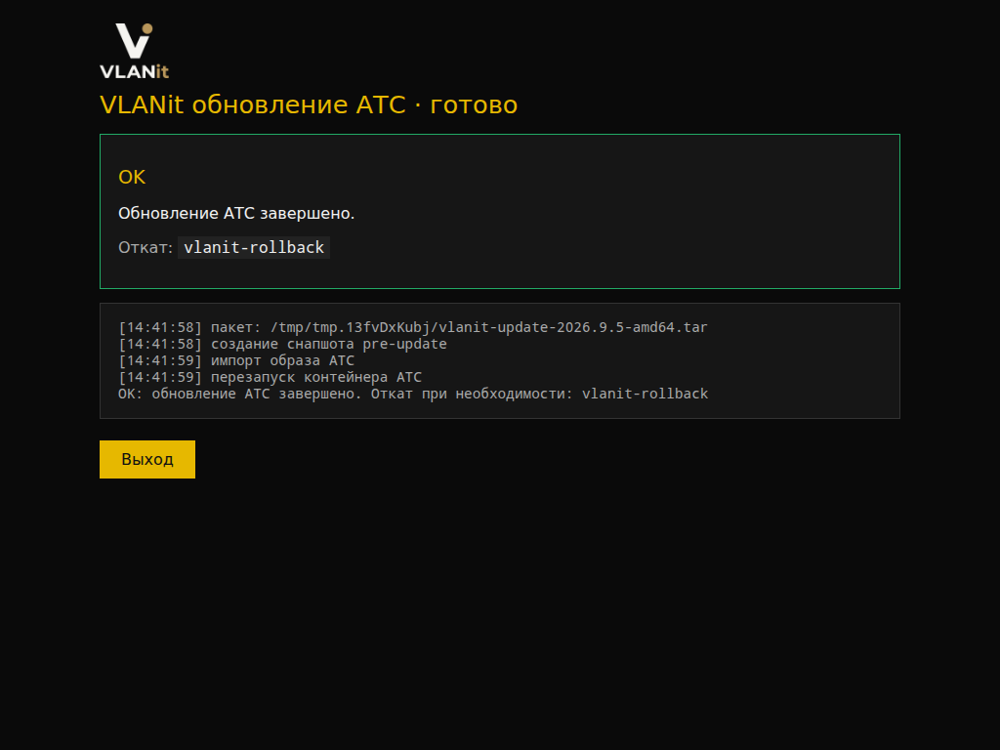

# Руководство: vlanit-update GUI

Мастер обновления образа MikoPBX на консоли (HTML + `netsurf-fb`).
Тот же визуальный стиль, что doctor: чёрный фон, золото `#e6b800`,
кнопки primary/secondary, logo из branding.
Issue [#58](https://github.com/vlanit-com/vlanit-pbx-os/issues/58).
Спека: [`docs/specs/vlanit-update-gui.md`](specs/vlanit-update-gui.md).
Связано: doctor GUI [`docs/doctor-gui.md`](doctor-gui.md), pin/bump
[`docs/specs/mikopbx-update.md`](specs/mikopbx-update.md).

Скрины ниже — mock (`scripts/shot-update-gui.sh`). На устройстве тот же UI;
пакет с USB, путь реальный.

Пересъёмка:

```bash
bash scripts/shot-update-gui.sh
# → docs/update-gui/shots/*.png
# → docs/doctor-gui/shots/05-overview-update.png, 06-handoff.png
```

## Запуск

```bash
sudo vlanit-update --gui
# или с явным пакетом:
sudo vlanit-update --gui /media/…/vlanit-update-*.tar
```

Нужны `/dev/fb0` и `netsurf-fb`. Иначе exit ≠0 и hint CLI:
`vlanit-update [пакет]`. Стенд QEMU: `VLANIT_FB_SURFACE=sdl`.

Из **doctor GUI**: кнопка **Обновить АТС** (если USB-пакет найден) →
handoff сюда; без FB — fallback CLI на консоли.

## Пошагово

### 1. Выбор пакета

USB с `vlanit-update-*.tar` + `.asc` (GPG). Один или несколько кандидатов.



### 2. Сводка и confirm

Показ пути/размера. Будет снапшот `pre-update`. Без **YES** система не
меняется. Откат позже: `vlanit-rollback`.



### 3. Применение

Снапшот → import образа → `Image=` в quadlet → restart mikopbx → health.



### 4. Готово

OK и хвост лога. При сбое — текст ошибки и `/var/log/vlanit-update.log`.



## CLI (без GUI)

```bash
vlanit-update                          # сканирует USB
vlanit-update /path/to/vlanit-update-*.tar
vlanit-update --online                 # если настроен update_url
VLANIT_ASSUME_YES=1 vlanit-update …    # неинтерактивно (агент/скрипты)
```
